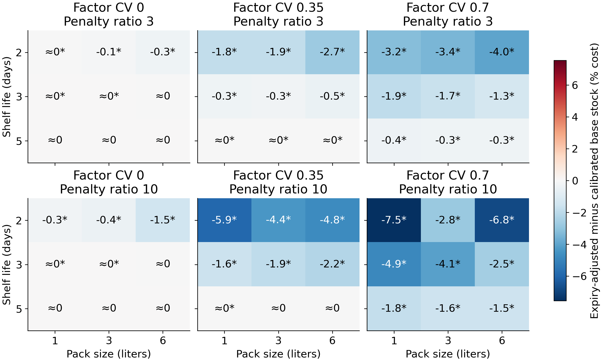
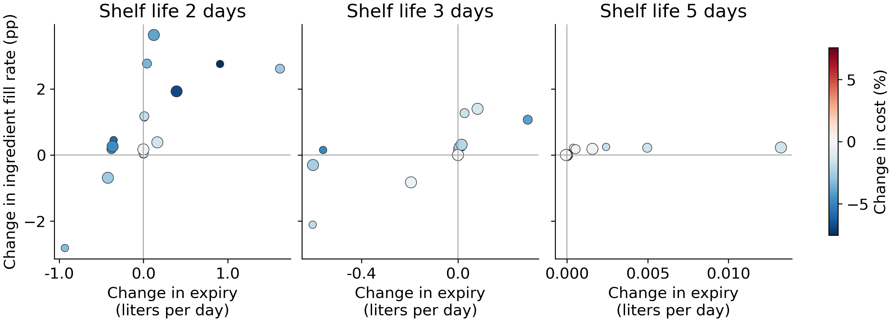

# Pack sizes and expiry information in shared ingredient cafe replenishment

Kyunghan Bae

Independent researcher and F&B operator, South Korea

11 October 2026

## Abstract

We compare three daily replenishment rules for one perishable ingredient shared by three cafe beverages. A factorial simulation varies pack size, shelf life, shared daily demand variability and the penalty for unmet ingredient demand across 54 settings. A pooled mean rule is accompanied by two rules whose safety parameters are calibrated on separate validation paths. The expiry-adjusted rule adds the volume predicted to expire under deterministic mean depletion to the replenishment requirement. All methods receive the same weekday forecasts and operate with one-day delivery, FIFO withdrawal and whole-pack ordering. Across 200 independent evaluation replications per setting, expiry adjustment has a lower mean daily cost with a pointwise 95% interval below zero in 40 settings, a higher cost in 4 (each estimated increase below KRW 0.01 per day), and an interval containing zero in 10. The median relative cost difference is -0.41%, and the largest estimated decrease is 7.54%. A separate three-year horizon experiment checks eight preselected extreme settings. The comparison shows where this particular age correction changes the cost and service tradeoff after both rules have been calibrated. The simulator, frozen protocol and full replication-level outcomes support independent reanalysis.

## Research question and prior work

Keywords: perishable inventory; shared ingredient; pack size; FIFO; simulation

A cafe can use the same milk stock in beverages with different recipes. The operational decision is how many supplier packs to commit to before the next day's demand is observed. Stock age matters because part of the available volume may expire before it is consumed. This study asks whether adding a simple forecast of such expiry improves a pooled order-up-to rule after each policy receives the same opportunity to calibrate its safety parameter.

Pack constraints and correlated demand have been studied together in periodic review inventory systems by Yan, Robb and Silver (2009). Their setting concerns multiple retail branches and a distribution center. Perishable replenishment with fixed packs, FIFO and age information is developed in much greater depth by van Donselaar and Broekmeulen (2025). Gioia, Felizardo and Brandimarte (2023) also provide a simulation framework for perishable products with seasonal demand and consumer choice. The present study provides a fully specified, small shared-ingredient benchmark and a controlled comparison of the particular mean-depletion correction defined below.

The existing fnb-procure v0.6.0 software computes static recipe requirements, shared ingredient stock deductions and exact whole-pack rounding. Its source provides the operational starting point for this study. The daily simulator is independently implemented and adds stochastic demand, cohort ages, delivery timing and evaluation against alternatives. The experiment uses generated demand throughout.

## Demand and inventory model

One quantity unit is 50 ml of milk. Three menus use 4, 5 and 6 units per beverage, with base mean daily beverage counts 18, 12 and 8. Expected aggregate demand is therefore 180 units, or 9 liters, on a day with multiplier one. The seven weekday multipliers are 0.80, 0.90, 0.95, 1.00, 1.20, 1.40 and 0.75, with average one. They repeat deterministically from the first simulated day.

For each day and replication, a common factor F has mean one and coefficient of variation v. When v is positive, F follows a gamma distribution with shape 1/v² and scale v². Conditional on F, the three menu counts are independent Poisson variables with means equal to the menu base mean times the weekday multiplier times F. For v = 0, F equals one. Milk demand is the recipe-weighted sum of these counts. Daily factors are independent over time. The factor CV takes values 0, 0.35 and 0.70. Raising it increases both cross-menu dependence and marginal demand variance; this experiment measures that combined change.

Let μ denote the aggregate mean on a given day and λ denote the vector of conditional menu means at F = 1. If r is the recipe vector, aggregate demand variance is the sum of r² times λ plus v²μ². The policies receive the true weekday mean and variance. This controls forecast quality while comparing replenishment decisions. Future realized demand remains unavailable at order time.

At the beginning of day t, yesterday's order arrives with its full remaining shelf life. A new order is then committed for delivery at the start of day t + 1. Realized milk demand is served by withdrawing the oldest stock first. Remaining stock with one day of life expires at day end, and the other cohorts age by one day. Shortage is the milk volume requested but unavailable, measured in the same units as inventory. A fractional final beverage can therefore be represented in the volume model; the service measure is an ingredient fill rate rather than a count of fulfilled customer orders.

## Replenishment rules and cost

The protection period consists of today and tomorrow. Its target is the sum of their forecast means plus z times the square root of their summed forecast variances, with a lower bound of zero. The daily factors are independent, so these variances add. The mean base-stock rule fixes z at zero. The calibrated base-stock rule selects z from the validation grid.

For expiry adjustment, a copy of the current age cohorts is depleted in FIFO order using today's forecast mean. Any remaining life-one stock is counted as projected expiry, after which the cohorts age. The same calculation is performed using tomorrow's forecast mean. The resulting two-day projected expiry is added to the base-stock replenishment requirement. This is a deterministic mean-depletion calculation, not the stochastic expectation of waste. It excludes the order being chosen, which arrives tomorrow with a new full shelf life.

The ordinary rules order the positive difference between the target and total available inventory, rounded upward to a whole number of supplier packs. The expiry-adjusted rule uses total available inventory minus projected expiry in that difference. Previously placed one-day orders have already arrived when the order is calculated. All rules have access to cohort ages; the ordinary rules use only their total. The study compares ways of using the same information.

Purchase commitments cost KRW 100 per 50 ml, equivalent to KRW 2,000 per liter. The shortage penalty is either 3 or 10 times that unit purchase cost. Holding cost is KRW 0.25 per unit of closing unexpired inventory per day. There is no separate disposal fee. Daily cost is committed purchases plus the ingredient shortage penalty plus holding cost. The purchase cost of expired stock is already included in committed purchases and is not added again. End-of-horizon stock is reported as inventory; it is not labeled as waste. Outstanding orders are retained in the commitment accounting and in the saved final pipeline quantity.

## Experimental design

The factorial design combines pack sizes 1, 3 and 6 liters; shelf lives 2, 3 and 5 days; the three common-factor CVs; and the two shortage penalties. There are 54 settings. Each calibrated rule selects z independently in each setting from −1.0, −0.5, 0, 0.5, 1.0, 1.5, 2.0, 2.5 and 3.0, using the smallest average validation cost. Ties select the lower z. Thirty independent validation paths precede evaluation on 200 new paths. Both periods use 90 burn-in days followed by 365 measured days. The complete grid and seeds were recorded in protocol.json before running the main experiment.

All methods use common demand paths within a setting. Settings with the same factor CV also share generated demand, allowing controlled cross-setting comparisons. Replications are independent within each CV experiment. The uncertainty calculation treats one entire 365-day replication as an observation, rather than treating the dependent days of an inventory path as independent data.

For each setting we form 200 paired daily-cost differences, expiry-adjusted minus calibrated base stock. A two-sided Student-t interval uses the sample standard deviation of those differences divided by the square root of 200. Intervals describe Monte Carlo error conditional on the chosen validation parameters and model. They do not include uncertainty in real store parameters or safety-parameter selection. All 54 cells are reported, and their intervals are pointwise rather than a familywise multiple-comparison procedure. Counts of positive and negative cells summarize this fixed design.

The preselected horizon sensitivity uses packs of 1 and 6 liters, shelf lives of 2 and 5 days, factor CV 0.70 and both penalties. These eight settings use new seeds, 180 burn-in days, and 1,095 measured days, with fresh validation and evaluation. The longer horizon reduces the relative importance of ending inventory and outstanding order commitments. It also changes the validation sample duration, so a change in calibrated z can contribute to differences between the runs.

## Results

Table 1 summarizes all 54 paired comparisons by shelf life. The relative difference is measured against the calibrated base-stock cost in each setting. The equal-weight mean within each group is a description of these selected settings.

| Shelf life | Mean cost difference % | Lower cost CI | Higher cost CI | CI includes zero |
| --- | --- | --- | --- | --- |
| 2 days | -2.89 | 18/18 | 0/18 | 0/18 |
| 3 days | -1.29 | 12/18 | 4/18 | 2/18 |
| 5 days | -0.33 | 10/18 | 0/18 | 8/18 |

Table 1. Comparison of expiry adjustment with calibrated base stock. A negative percentage favors expiry adjustment. Interval categories refer to paired daily cost and pointwise 95% intervals.

Figure 1. Relative daily cost difference across the full factorial design. An asterisk marks a paired pointwise 95% interval excluding zero; ≈0 means an absolute relative difference below 0.05%. The complete values and intervals are in results/paired_comparisons.csv.

The largest estimated relative cost decrease occurs in Q20_M2_CV0.7_P10: -7.54% or -2594.77 KRW per day, with a paired 95% interval [-2801.24, -2388.30]. It accompanies an ingredient fill-rate change of +2.76 percentage points and an expiry change of +0.91 liters per day. Lower cost in this setting does not mean less expired milk. The largest relative increase occurs in Q60_M3_CV0_P3: +0.000055% or +0.009863 KRW per day, with interval [+0.006865, +0.012861]. These are descriptive extremes of the fully reported grid, not separately preselected superiority tests.

Figure 2. Paired changes in expired liters and ingredient fill rate. Each point is a setting; larger symbols indicate larger packs, and color shows relative cost change. The horizontal and vertical zero lines identify service and waste tradeoffs.

The calibrated parameter reached an endpoint of the search grid in 22 of the 108 calibrated policy-setting fits. All selected parameters and validation costs are retained in results/calibration.csv. The mean base-stock comparator and absolute volumes are included in results/scenario_results.csv. In 13 settings the absolute estimated difference is below KRW 1 per day. Pointwise statistical separation in such cells has little economic magnitude under the assumed prices, so interval counts should be read together with Figure 1 and absolute cost differences.

| Pack L | Life days | Penalty ratio | Main cost difference % | Long run difference % | Long run 95% CI KRW/day |
| --- | --- | --- | --- | --- | --- |
| 1 | 2 | 3 | -3.23 | -3.18 | [-872.8, -809.5] |
| 1 | 2 | 10 | -7.54 | -7.60 | [-2758.6, -2533.3] |
| 1 | 5 | 3 | -0.38 | -0.38 | [-80.9, -69.7] |
| 1 | 5 | 10 | -1.78 | -1.80 | [-424.8, -363.2] |
| 6 | 2 | 3 | -3.98 | -4.03 | [-1097.3, -1040.2] |
| 6 | 2 | 10 | -6.82 | -6.66 | [-2374.4, -2182.2] |
| 6 | 5 | 3 | -0.31 | -0.33 | [-70.9, -59.6] |
| 6 | 5 | 10 | -1.55 | -1.53 | [-366.9, -302.5] |

Table 2. Preselected long-horizon sensitivity at factor CV 0.70. Signs of the point estimates agree with the main experiment in 8 of eight settings. Near-zero differences should be read with their intervals and the parameter choices in the calibration files.

After observing validation-grid upper-boundary choices, a supplemental analysis repeated the 11 affected settings with z values up to 5.0 for both rules. It reused the original validation paths and used fresh evaluation seed 2026101105 with 200 replications. Three settings selected z = 3.5 for both rules, and no fit selected the new upper boundary. Six paired point estimates were negative and five exactly zero; only one pointwise cost interval excluded zero. Two primary cells with 1-liter packs, three-day life and factor CV zero had tiny positive differences; on the fresh paths their estimates were negative with intervals containing zero, while their selected parameters remained unchanged. The other two positive primary cells were outside this supplement. Full results are in boundary-sensitivity/. This follow-up was triggered by validation-boundary selection and is reported separately from the frozen primary grid.

## Verification and interpretation

Executable checks cover FIFO withdrawal, one-day delivery, expiry at the end of the final usable day, daily conservation of ingredient volume, whole-pack ordering, nonnegative inventory, absence of double-counted expiry cost, random-stream reproducibility, demand moments and vectorized agreement with separate parameter runs. The experiment checks inventory conservation during every simulated day. An independent scalar implementation additionally compares the vectorized cohort simulator on small paths and records its findings in MODEL_REVIEW.md.

The findings apply to these forecast distributions, cost ratios and rules. Known demand parameters remove forecast error, while unlimited supplier capacity and a single shared ingredient remove several real operational constraints. The linear ingredient shortage penalty is a modeling preference, not an estimated lost-sale value. Customer choice, substitutions, whole-order fulfillment, refrigeration capacity, supply delays and intraday milk handling are outside the model. No field sales or inventory observations enter the experiments.

A useful next extension is to match a venue's recipe quantities, supplier pack sizes and receiving dates, estimate forecast error on a training period, and test the same frozen rules on a later period. Within the present controlled design, the paired results identify the settings where this specific expiry correction merits that further evaluation. They also preserve settings where calibration removes its apparent advantage or where it raises total cost.

## Reproducibility and availability

Run python -m unittest test_study -v, python study.py, python study.py --sensitivity, python boundary_sensitivity.py, and python make_report.py after installing requirements.txt. The package contains the protocol, independent simulator, tests, full scenario summaries, validation grid, replication-level outcomes, run metadata and generated figures. Summary volume columns are in liters; replication_results.csv retains the base 50 ml quantity unit. Cost columns are KRW per measured day, and fill rates are fractions. The software is provided under the MIT License and the manuscript and generated results under CC BY 4.0. Third-party articles are referenced through their source links.

## References

Yan, X. S., Robb, D. J., and Silver, E. A. (2009). Inventory performance under pack size constraints and spatially-correlated demand. International Journal of Production Economics, 117(2), 330–337. https://doi.org/10.1016/j.ijpe.2008.11.006

van Donselaar, K., and Broekmeulen, R. (2025). Easy-to-use estimators for waste, on shelf availability and number of orders in a periodic review inventory system with perishable items. International Journal of Production Economics, 284, 109608. https://doi.org/10.1016/j.ijpe.2025.109608

Gioia, D. G., Felizardo, L. K., and Brandimarte, P. (2023). Simulation-based inventory management of perishable products via linear discrete choice models. Computers and Operations Research, 157, 106270. https://doi.org/10.1016/j.cor.2023.106270

Bae, K. (2026). fnb-procure v0.6.0. Source commit cb18575a2dba163c0ea87699634872de94a68243. https://github.com/qorud02/fnb-margin-kit/releases/tag/v0.6.0
